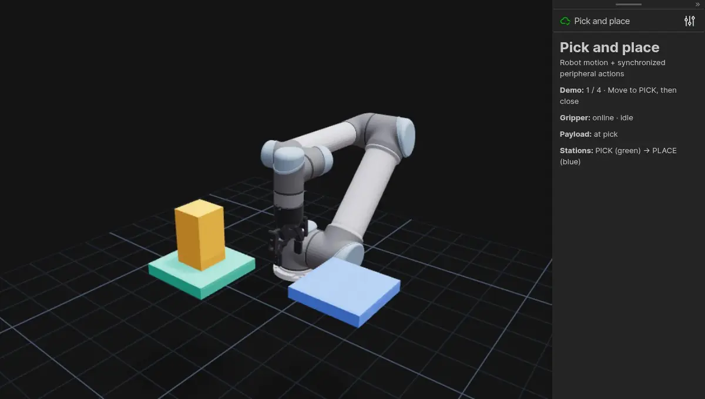

# Orchestrion

Coordinate robot motion and peripheral tasks in Python. Submit a trajectory,
schedule a gripper or camera action after it, and wait for the result.

## Install

Python 3.9+; the core package has no runtime dependencies. From the repository root:

```bash
python -m pip install -e .
```

## Move, then grip

Run this example without robot hardware:

```python
from concurrent.futures import ThreadPoolExecutor

from orchestrion import CallableTask, MoveSyncOption, SimulatedRobotTask, TaskPilot


def grip(request_id, command):
    return {"gripper": command["action"]}  # Replace with a device SDK call.


with TaskPilot(
    SimulatedRobotTask([0.0, 0.0]),
    {"gripper": CallableTask(grip)},
    executor_owned=ThreadPoolExecutor(max_workers=1),
) as pilot:
    pilot.move_joint_trajectory_async([[0.2, 0.1], [0.4, 0.2]], interval=0.05)
    request_id = pilot.call_srv_async(
        "gripper", {"action": "close"}, MoveSyncOption.sync_w_latest_move()
    )
    result = pilot.wait_request(request_id, timeout=2.0)
    print(result.status.value, result.content)
```

Output: `succeeded {'gripper': 'close'}`. The context manager stops the pilot and
its owned executor. A wait timeout raises `TimeoutError`; check the returned
status for device failures.

## Run a demo



The gripper closes to the object's width. The arm lifts before transferring the
payload and retreats above the station after release.

Run `python -m examples.simulated_pick_and_place` for a complete cycle. It prints
the joint position observed by each gripper call. For the interactive UR5/Robotiq view:

```bash
python -m pip install -e ".[viser]"
python -m examples.viser 02
```

Open <http://localhost:8080>; motion starts when the browser connects. Stop with
Ctrl+C. See the [Viser demos](examples/viser/README.md) for remote access and controls.

## Go further

- [TaskPilot guide](docs/task-pilot.md): synchronization, lifecycle, adapters and health.
- [Experimental workflows](docs/workflows.md): DAGs, resources, cancellation and durable execution.
- [Dual-arm examples](examples/dual_arm/README.md).
- [Development and tests](tests/README.md).
