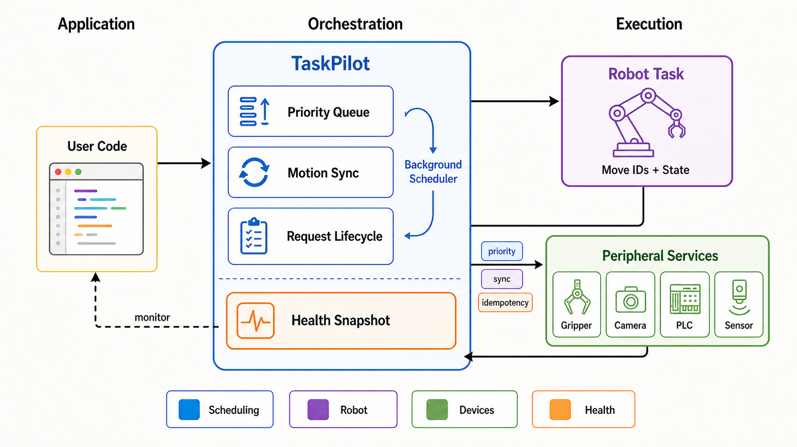
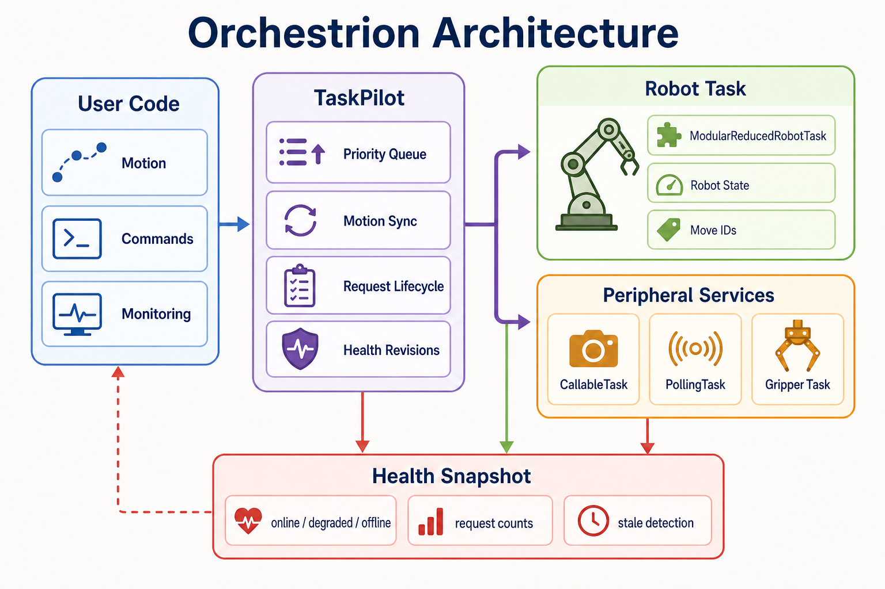
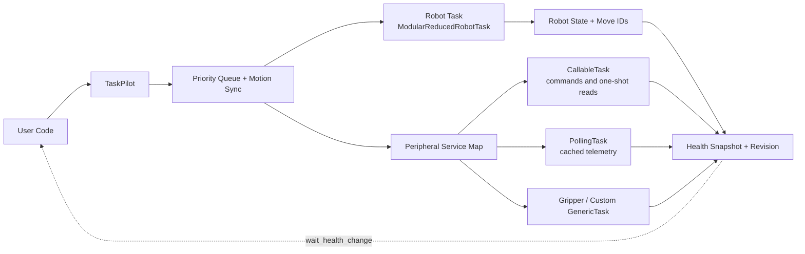

# Orchestrion

Lightweight Python framework for coordinating robot motion and asynchronous peripheral tasks.

Orchestrion centers around TaskPilot, which schedules robot trajectories and side tasks (for example, gripper actions) with optional motion synchronization.

For heterogeneous workflows spanning arms, fixtures, speech, vision, and mobile
bases, the experimental `orchestrion.workflow` API adds a device-independent DAG
engine with resource scheduling. See the [architecture and migration design
(中文)](docs/architecture-v3.md) for its contracts, current scope, and roadmap.



## Features

- Task-based architecture for robot and peripheral execution.
- Asynchronous peripheral calls with in-memory or thread-pool execution strategies.
- Synchronization policies via MoveSyncOption:
  - run immediately (no sync)
  - sync with latest robot move
  - sync with an explicit move ID
- Modular robot abstraction with main module plus submodules.
- Unified request lifecycle with wait, cancellation, failures, and bounded timelines.
- Event-driven scheduling with polling fallback for legacy robot backends.
- Event-driven health revisions, normalized device health, and stale-data detection.
- Callable command adapters, bounded retries, and cached polling tasks for telemetry.
- Declarative request schemas that reject malformed commands before device I/O.
- Nested object/array contracts and workflow output validation before downstream dispatch.
- Hardware-free `SimulatedRobotTask` for demos and integration tests.
- Experimental workflow DAGs with output bindings, shared resource capacities,
  cooperative cancellation, explicit submission deduplication, wait diagnostics,
  and quarantine of operations with uncertain outcomes.

## Heterogeneous workflows (experimental)

```python
import asyncio
from orchestrion.workflow import (
    Action, Node, OutputRef, Resource, ResourceClaim, Workflow, WorkflowEngine,
)

async def detect(context, inputs):
    return {"pose": [0.4, 0.1, 0.2]}  # Replace with a vision adapter.

async def move(context, inputs):
    await context.sleep(0.01)  # Simulation; real adapters must confirm completion.
    return {"reached": inputs["pose"]}

async def main():
    async with WorkflowEngine([
        Action("vision.detect", detect),
        Action("arm.move", move, (ResourceClaim("arm"),)),
    ], [Resource("arm")]) as engine:
        run = engine.submit(Workflow((
            Node("detect", "vision.detect"),
            Node("move", "arm.move", {"pose": OutputRef("detect", ("pose",))}),
        ), timeout=2), idempotency_key="pick-cycle-42")
        print(await run.wait(timeout=3))

asyncio.run(main())
```

Run `python -m examples.heterogeneous_workflow` for a complete simulated cell, or
add `--preview` to compile its plan without executing actions. A `Planner` proposes
a workflow using the capability catalog; the engine validates it before dispatch.
Action claims are mandatory floors and apply across every run in the same engine.
Actions can declare `input_schema` and `output_schema` with `RequestSchema`.
Declared outputs must be JSON objects; validation happens before success and
downstream admission. Invalid results fail their producer with `ActionOutputError`
in the node error, preserve JSON output for diagnosis, and skip dependent nodes.
An output contract does not confirm physical termination; adapter completion must
still mean the device has finished. The planner catalog exposes both contracts.

When a source declares an output contract, compilation rejects impossible
`OutputRef` paths such as an unknown closed-object field, indexing a string, or
reading index 3 of an array with `max_items=3`. Optional fields and open/dynamic
structures still require runtime checks.

Compilation also validates the known parts of inputs containing `OutputRef`:
required fields, literal types/ranges, nested fields, array lengths and known
parts of composite choices. A reference does not postpone unrelated input errors
until after upstream device actions. Bound values receive full validation again
before their adapter starts; rejected plans do not reserve an idempotency key.

Use `BlockingAction` for blocking SDK calls; async handlers must keep the loop free.
It uses a supplied `ThreadPoolExecutor` or the event loop's default thread pool.
Cancellation is checked again when a queued SDK wrapper gets a worker, before
device I/O. Already started calls drain before releasing their claims. SDK callback
threads can report JSON progress with `context.report()`; late feedback is dropped.

SDK progress uses one bounded queue per action. Set
`max_pending_feedback_per_action` on the engine (default 128). Overflow discards
oldest pending progress, emits `feedback_overflow` events, and records the total in
`NodeResult.feedback_dropped`, even if event history has been evicted. Delivery
yields after batches of 32; completion flushes the remaining bounded queue before
recording the final state. Loop-local reports are delivered directly. This channel
is for progress; required results belong in the final output or device protocol.

Cancellation requests a stop and retains resource claims until the adapter confirms
completion. `ExecutionUncertain` quarantines claims until external reconciliation;
an accepted remote command or cancellation request is not a final result. Wait
timeouts only limit the caller's wait. `Workflow(timeout=...)` applies one execution
budget across dependency waits, resource queues, and running actions; expiry stops
admission and requests cancellation while device cleanup retains resource claims.
`Node(timeout=...)` starts its budget at execution. With `FAIL_FAST`, node expiry
stops sibling admission immediately, before cleanup finishes.

Actions must express ordering through graph dependencies; attempting to await a run
or close their own engine from inside an action raises `RuntimeError` to prevent
waiting cycles. The new engine is local to one event loop,
has no durable crash recovery yet, and does not replace motion planning or real-time
control. Give each physical device one command owner when migrating from TaskPilot.

Use `submit(workflow, idempotency_key="cycle-42")` to deduplicate caller retries in
the same engine. Identical retained submissions return the original `WorkflowRun`,
including failed or cancelled outcomes; a changed execution snapshot raises
`ValueError`. Keys are reserved before action dispatch and do not restart deadlines.
Retrieve a retained handle with `engine.get_run_by_key("cycle-42")`.

`max_idempotency_keys` defaults to 1024; reaching it rejects new keyed submissions
without silently evicting old keys. Explicitly call
`engine.prune_idempotency_keys(keep_last=1000)` to forget older settled submissions.
Active runs and unreconciled unknown operations are preserved. Pruning permits those
keys to execute again; existing handles remain valid. Unkeyed completed runs are
not retained by the engine unless they have unknown operations. Key retention is
in memory and does not provide deduplication across engines or process restarts.

For operational diagnostics, `run.explain("move")` returns dependency, concurrency,
resource-capacity, queue-order, stop-confirmation, or quarantine blockers.
`engine.scheduler_snapshot()` reports counts, resource owners and queue heads,
and retained/prunable key counts. These JSON-compatible reads use the engine's
event loop, scan current state on demand, and perform no device calls.
Node explanations also report pending/dropped feedback counts. An unexpected
scheduler exit closes admission and records `scheduler_error` in the engine
snapshot. Unstarted actions fail without device I/O; running actions receive a
stop request and keep their claims until confirmed quiescent. `aclose()` continues
waiting for that cleanup independently of the failed scheduler. Unknown operations
remain quarantined; the engine does not restart itself after a scheduler fault.

## Package Overview

- `orchestrion.task_pilot.TaskPilot`
  - Main orchestrator.
  - Queues background task requests.
  - Dispatches immediate tasks and synchronized tasks.
- `orchestrion.move_sync_option.MoveSyncOption`
  - Sync policy object for peripheral task calls.
- `orchestrion.tasks.modular_reduced_robot_task.ModularReducedRobotTask`
  - Base implementation for modular robot movement handling.
  - Exposes independent submodule move IDs, state, waiting, and cancellation.
- `orchestrion.tasks.function_call_task.InPlaceFunctionCallTask`
  - Executes function calls inline and stores responses in memory.
- `orchestrion.tasks.function_call_task.ThreadedPoolFunctionCallTask`
  - Executes function calls in an external `ThreadPoolExecutor`.
- `orchestrion.tasks.function_call_task.CallableTask`
  - Wraps SDK functions as asynchronous services with optional bounded retry.
- `orchestrion.tasks.polling_task.PollingTask`
  - Polls continuous telemetry in the background and serves cached samples.
- `orchestrion.health.DeviceHealth`
  - Defines normalized connectivity and readiness states for device adapters.
- `orchestrion.utils.types.PeekResponseResult`
  - Unified response/result envelope for asynchronous task polling.

## Installation

### Prerequisites

- Python `>= 3.9`

### Install from source

```bash
pip install -e .
```

### Optional dependencies

- Logging colors:

```bash
pip install -e ".[color]"
```

- Viser demo stack:

```bash
pip install -e ".[viser]"
```

## Quick Start

```python
from orchestrion import MoveSyncOption, SimulatedRobotTask, TaskPilot
from orchestrion.tasks import InPlaceFunctionCallTask

class GripperTask(InPlaceFunctionCallTask):
    def _call_fn(self, request_id, content):
        return {"applied": content["action"]}

pilot = TaskPilot(SimulatedRobotTask([0.0, 0.0]), {"gripper": GripperTask()})
pilot.initialize()
try:
    _, move_end = pilot.move_joint_trajectory_async(
        [[0.0, 0.1], [0.2, 0.3]], interval=0.01
    )
    request_id = pilot.call_srv_async(
        "gripper",
        {"action": "close"},
        MoveSyncOption.sync_w_explicit_id(move_end - 1),
        priority=10,
        idempotency_key="pick-cycle-42/close",
    )
    result = pilot.wait_request(request_id, timeout=2.0)
    print(result.status, result.content)
finally:
    pilot.stop()
```

Run the complete example from the repository root with
`python -m examples.simulated_pick_and_place`.

## Request Lifecycle

Every peripheral request progresses through `QUEUED`, optionally
`WAITING_FOR_MOVE`, then `RUNNING`, and finally `SUCCEEDED`, `FAILED`, or
`CANCELLED`.

```python
snapshot = pilot.query_request(request_id)
result = pilot.wait_request(request_id, timeout=1.0)
results = pilot.wait_requests(request_ids, timeout=2.0)
cancelled = pilot.cancel_request(request_id)
cancelled_ids = pilot.cancel_all_requests(service_name="camera")
events = pilot.timeline(request_id)
removed = pilot.prune_completed_requests(keep_last=1000)
gripper_status = pilot.query_task_status("gripper")
all_peripherals = pilot.query_all_task_statuses()
health = pilot.query_health()
next_health = pilot.wait_health_change(health["revision"], timeout=5.0)
service_catalog = pilot.describe_services()
```

For applications that give the pilot lexical ownership, use its context manager
to guarantee shutdown:

```python
with TaskPilot(robot, {"gripper": gripper}, executor_owned=executor) as pilot:
    request_id = pilot.call_srv_async("gripper", {"action": "close"})
    result = pilot.wait_request(request_id, timeout=2.0)
```

`pilot.is_running` exposes lifecycle state, `pilot.service_names` lists registered
peripherals, and `pilot.task_map` returns a defensive copy of the registry.

`wait_request` raises `TimeoutError` without cancelling the request. Cancellation
is guaranteed before execution and best-effort once a task is running.
`wait_requests` applies one shared timeout budget to the entire group rather than
resetting the timeout for each request. It validates every ID before waiting and
protects the whole group's results from concurrent pruning until it returns or
times out. `cancel_all_requests` can target all active
work or only one peripheral service.
Higher integer `priority` values run before lower-priority queued work. Priority
never preempts a running device action, and equal priorities preserve request-ID
order. Immediate requests and requests whose motion conditions have been met
compete in the same priority queue.
An optional `idempotency_key` deduplicates concurrent or repeated submissions for
the same service and returns the original request ID. Keys remain active while the
request is retained; `prune_completed_requests()` releases keys belonging to
removed records. Use stable operation IDs for actuator and PLC commands that may
be retransmitted after a network timeout.
Long-running processes can call `prune_completed_requests()` periodically to bound
stored terminal request results without removing active work.
Task result caches and the pilot's request history are independent. A positive
`max_result_count` on a function task limits retained completed responses; pending
thread-pool work is always preserved. Allow enough space for a burst of concurrent
completions, since a response evicted before collection becomes an explicit failed
request. Inline responses are collected before the next inline call runs.
Request-ID deduplication metadata remains for the lifetime of a task, including
after response pruning; sparse IDs may therefore retain additional identifier
history.

`InPlaceFunctionCallTask` runs on the scheduler thread. Use it for short local
operations; use `CallableTask` or `ThreadedPoolFunctionCallTask` with an executor
for blocking device I/O. Completion notifications refresh only affected services,
and `poll_interval` provides fallback polling for adapters without notifications.
An idle pilot sleeps until new work or a component notification arrives.

Peripheral tasks can expose live health through `peek_status()`. TaskPilot provides
`query_task_status()` and `query_all_task_statuses()` as a uniform monitoring API;
built-in function tasks report retained, pending, succeeded, failed, and cancelled
request counts. A direct status query surfaces device errors to the caller. The
batch query is best-effort: a failing device returns
`{"available": False, "error": "..."}` without hiding healthy peripherals.
`query_health()` combines scheduler liveness, robot state, request counts, and all
peripheral statuses into one JSON-compatible snapshot for HTTP health endpoints,
dashboards, or metrics exporters.
Every snapshot contains a monotonic `revision`. `wait_health_change()` blocks until
robot, request, or peripheral state advances beyond that revision and returns
`None` on timeout, enabling event-driven dashboards without busy polling.
`describe_services()` returns static, JSON-compatible task type, execution mode,
capabilities, retry configuration, polling interval, and adapter metadata without
contacting hardware. Use it for service discovery and automatically generated UIs.

Simple SDK or I/O functions can be exposed without defining a task subclass:

```python
from orchestrion import CallableTask, FieldSpec, RequestSchema

camera = CallableTask(
    lambda request_id, content: camera_sdk.capture(**(content or {})),
    status=lambda: {
        "health": "online",
        "observed_at": camera_sdk.last_frame_time,
        "device_type": "camera",
    },
    request_schema=RequestSchema(
        {
            "exposure_ms": FieldSpec(
                "number", required=True, minimum=0.1, maximum=100.0
            )
        }
    ),
    metadata={"commands": ["capture"], "device_type": "camera"},
)
```

`RequestSchema` validates command dictionaries before retry or adapter
execution. Its JSON-compatible description is included in `describe_services()`,
so control panels can discover required fields, numeric limits, and choices.
Schemas snapshot their field constraints at construction, and integer bounds keep
their exact precision even above the floating-point integer range.

Use `items`, `min_items` and `max_items` for arrays, and `object_schema` for nested
objects. Errors identify paths such as `objects[0].pose[1]`:

```python
pose_result = RequestSchema({
    "pose": FieldSpec(
        "array", required=True, items=FieldSpec("number"), min_items=3, max_items=3,
    ),
    "frame_id": FieldSpec("string", required=True, choices=["workcell"]),
})
move_input = RequestSchema({
    "detection": FieldSpec("object", required=True, object_schema=pose_result),
})
```

These constraints work in both `CallableTask` requests and workflow action
contracts. `RequestSchema.validate_path()` checks structural paths against a
contract; optional fields or short arrays can still be absent in actual data.
`validate_template(content, is_deferred=...)` checks known template values without
producing executable input. The workflow compiler uses it automatically; custom
planners must still resolve bindings and call `validate()` before dispatch.
Composite choices distinguish JSON booleans from numbers, including nested
confirmations such as `{"stopped": true}` versus `{"stopped": 1}`.

Run `python -m examples.simulated_multi_peripheral` for a hardware-free camera,
vacuum, PLC, and continuously polled temperature-sensor example. `CallableTask`
models commands and one-shot reads; `PollingTask` samples telemetry in the
background and serves the latest cached value. Pass `stale_after` to
`query_health()` to mark an online device as `degraded` when its adapter-provided
`observed_at` becomes too old.
Use `DeviceHealth` values (`unknown`, `connecting`, `online`, `degraded`, and
`offline`) in adapters; malformed health values and timestamps are rejected early.

### Network service demo

Run `python -m examples.network_service_demo` for an end-to-end HTTP example with
no external dependencies. The demo starts a simulated device on a loopback port,
moves the robot, submits a synchronized remote tool command, receives an operation
ticket, and long-polls until the remote action finishes.

The example separates protocol concerns into two modules:

- `examples.network_device_service` implements the device-facing HTTP service:
  `POST /commands`, `GET /operations/{id}?wait=...`,
  `DELETE /operations/{id}`, and `GET /health`.
- `examples.network_service_demo` implements `NetworkDeviceClient`, wraps it in a
  `CallableTask`, and waits for the final response through `TaskPilot`.

Each command carries both an Orchestrion `idempotency_key` and a protocol-level
`Idempotency-Key`. This distinction matters in production: the first deduplicates
local submissions, while the second prevents a remote actuator command from being
executed twice when the HTTP response is lost and the client retries. Only
connection failures are retried automatically; a remote operation timeout is
reported as a failed request for the application to reconcile explicitly.
Before reporting a response timeout, the demo client sends a best-effort remote
cancellation so an abandoned actuator operation does not continue unnoticed.

To inspect the device protocol independently, run
`python -m examples.network_device_service` and connect to port 8080. In a real
adapter, keep the same ticket/wait shape but replace the simulated service with the
device gateway, message broker, or RPC client used by the deployment.

Idempotent reads may opt into bounded retry with `RetryPolicy`. Retry is disabled
by default; do not enable it for non-idempotent actuator or PLC writes unless the
device protocol supplies an idempotency key:

```python
camera = CallableTask(
    capture,
    retry_policy=RetryPolicy(
        max_attempts=3,
        delay=0.1,
        backoff=2.0,
        retry_exceptions=(ConnectionError, TimeoutError),
    ),
)
```

Stopping a callable task interrupts retry backoff, including zero-delay retries.
Reinitialization starts a new lifecycle: an older invocation cannot resume its
retry sequence after the task is restarted.

## Synchronization Model

`TaskPilot.call_srv_async(...)` accepts a `MoveSyncOption`:

- `MoveSyncOption.no_sync()`
  - Task is executed as soon as the background loop dequeues it.
- `MoveSyncOption.sync_w_latest_move()`
  - Task is associated with the latest known move ID when the request is submitted.
- `MoveSyncOption.sync_w_explicit_id(move_id)`
  - Task runs only after robot state reports finishing that move ID.
- `MoveSyncOption.sync_w_submodule(name, move_id)`
  - Task runs after one arm, gripper, or other modular component finishes its move.
  - Cancelling the associated submodule move cancels the waiting service request.

The built-in robot backends discard unfinished main and submodule motion on
`stop()`. Main cancellations are available in
`query_state().cancelled_move_ids`, and dependent service requests become
`CANCELLED`. Cancellation history and completed IDs survive restart, so completing
a later move cannot turn a cancelled move into a successful synchronization.
Custom backends can populate the optional `ReducedRobotState.cancelled_move_ids`
field to provide the same behavior.

After stopping, built-in robots reject new motion until `initialize()` is called.
A trajectory or service request being prepared across a stop/restart boundary is
also rejected. If a scheduler or polling callback outlives shutdown, restart raises
`RuntimeError` until the previous worker has exited.

## Submodule Motion

Modular robots expose completion-aware motion for components such as grippers:

```python
move_id = robot.move_submodule_trajectory_async(
    "gripper", [[0.1], [0.2], [0.3]], interval=0.01
)
state = robot.query_submodule_state("gripper")
finished = robot.wait_submodule_move("gripper", move_id, timeout=1.0)
cancelled = robot.cancel_submodule_move("gripper", move_id)
```

`move_submodule_async()` remains as a boolean compatibility wrapper. New backends
should prefer the completion-aware API.

For coordinated components such as two arms, wait once against a shared deadline:

```python
moves = robot.move_submodules_trajectories_async(
    {"left_arm": left_path, "right_arm": right_path}
)
if not moves:
    raise ValueError("coordinated trajectories were rejected")
if not robot.wait_submodule_moves(moves, timeout=2.0):
    robot.cancel_submodule_moves(moves)
    raise RuntimeError("coordinated move failed")
```

The batch submission validates every trajectory before enqueuing any of them, so
an invalid right-arm command cannot leave the left arm moving alone. Use
`query_submodule_states()` when monitoring both arms to obtain one atomic snapshot.

Run `python -m examples.dual_arm --list` for seven hardware-free dual-arm demos:
parallel picking, payload handoff, shared-workspace safety interlocking, and
coordinated abort when either arm fails, plus remote inspection overlapping an
HTTP response wait with arm retreat.
The health-monitor demo additionally shows revision-based observation without
busy polling.
Add `--viser` to any selection, such as
`python -m examples.dual_arm 02 --viser`, to render two live UR5 models plus
gripper, shared-zone, and event status. Add `--replay` or `--loop-replay` for
recorded timeline playback with GUI scrubbing and speed controls. See
`examples/dual_arm/README.md` for
their service, visualization, and synchronization design.

## Architecture



The infographic provides the quick visual overview; the source-controlled diagram
below is the authoritative component map.



At runtime, TaskPilot accepts two streams of work:

- Robot trajectory requests.
- Peripheral task requests (with or without synchronization constraints).

The background loop executes non-synchronized tasks immediately and delays synchronized tasks until robot state satisfies the requested move condition.

## Viser Integration Example


Run the featured scene with `python -m examples.viser 02`. It visualizes the
arm trajectory, synchronized gripper state, attached payload, phase progress,
and live peripheral health in one browser view. The animation above is captured
from that real workflow rather than a mocked rendering.

See:

- `integrations/viser/viser_modular_robot_task.py`
- `examples/viser/README.md` for eight runnable visualization demos
- `examples/viser/viser_modular_robot_task.py` for the legacy entry point

The example demonstrates:

- Loading URDFs for arm and gripper.
- Building a modular robot task.
- Sending pick-and-place trajectories.
- Scheduling gripper open/close actions synchronized with arm moves.
- Monitoring request progress and peripheral health from the Viser panel.

## Running Tests

```bash
python -m pytest -q
python -m pytest -q tests/test_task.py
python -m pytest -q tests/test_task_pilot.py
python -m pytest -q tests/test_modular_robot_task.py
python -m pytest -q tests/test_workflow*.py tests/test_heterogeneous_workflow.py
ruff check .
```

Install `.[dev]` to run the core suite. Viser-specific tests skip when optional
visualization dependencies are absent; install `.[dev,viser]` to include them.
Unhandled worker-thread exceptions fail the suite. CI covers both installation
profiles and smoke-tests a built wheel in an isolated environment.

Tests are organized by behavior, with regressions kept beside the corresponding
contracts. See the [test map and concurrency guidelines](tests/README.md) for
focused commands and where to add coverage.

For repeatable performance comparisons, run:

```bash
python -m examples.benchmark_task_storage
python -m examples.benchmark_task_storage --reference HEAD --counts 1000 5000
```

The benchmark reports median timings for sparse request-ID submission and bounded
result retention with many pending futures. `--reference` loads the task code from
the selected local Git revision, using the current supporting modules. These are
framework microbenchmarks; they exclude device, network, and worker-thread latency.

## Development Workflow

1. Create and activate a virtual environment.
2. Install project in editable mode.
3. Install test/runtime extras as needed.
4. Run focused test files during development.

Example:

```bash
python -m venv .venv
source .venv/bin/activate
pip install -e .
pip install -e ".[dev,color,viser]"
python -m pytest -q tests/test_task.py
```

## Repository Structure

```text
orchestrion/
  task_pilot.py
  move_sync_option.py
  request.py
  health.py
  retry.py
  schema.py
  tasks/
    generic_task.py
    function_call_task.py
    modular_reduced_robot_task.py
    polling_task.py
    reduced_robot_task_interface.py
    simulated_robot_task.py
  utils/
    logger.py
    types.py

integrations/
  viser/
    viser_modular_robot_task.py

examples/
  dual_arm/
    01_parallel_pick.py ... 07_handoff_and_place.py
    common.py
  benchmark_task_storage.py
  network_device_service.py
  network_service_demo.py
  simulated_multi_peripheral.py
  simulated_pick_and_place.py
  viser/
    01_joint_sweep.py ... 08_gripper_lab.py
    common.py

tests/
  README.md
  test_dual_arm_examples.py
  test_heterogeneous_workflow.py
  test_legacy_api.py
  test_modular_robot_task.py
  test_network_demo.py
  test_robot_task.py
  test_schema.py
  test_task.py
  test_task_pilot.py
  test_viser_examples.py
  test_workflow.py
  test_workflow_cancellation.py
  test_workflow_contracts.py
  test_workflow_idempotency.py
  test_workflow_lifecycle.py
  test_workflow_observability.py
```

## Notes

- This repository is framework-oriented: concrete robot backends should subclass or implement the provided task interfaces.
- `executor_owned` is shut down by `TaskPilot.stop()`; do not reuse it afterward.
- `stop(timeout=...)` bounds the scheduler-thread join and shuts down the owned
  executor without waiting for running callbacks. Device shutdown hooks and I/O
  must supply their own timeouts; Python callbacks require cooperative exit.
- After a scheduler join times out, calling `stop()` again can wait for that worker
  to exit. Restart is rejected while it is still stopping.

## Troubleshooting

- Colored logs are optional; install them with `pip install -e ".[color]"`.
- `pytest: command not found`
  - Use `python -m pytest ...` inside your virtual environment, or install `pytest` first.
- Synchronized peripheral calls do not run yet
  - Check `MoveSyncOption` and verify robot state's `latest_finished_id` has reached the target move ID.
