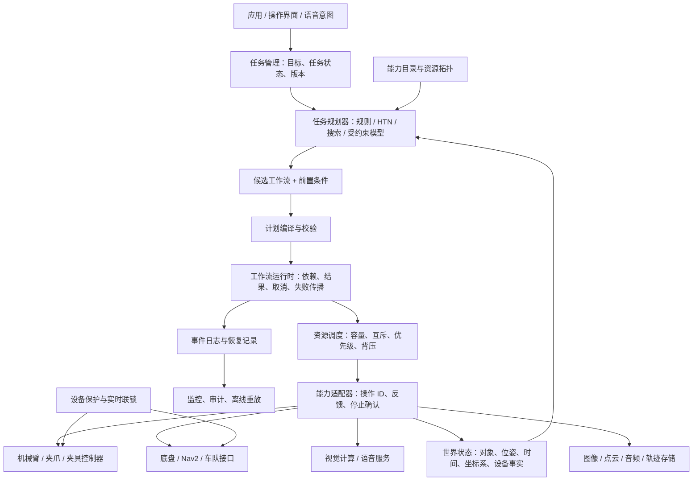
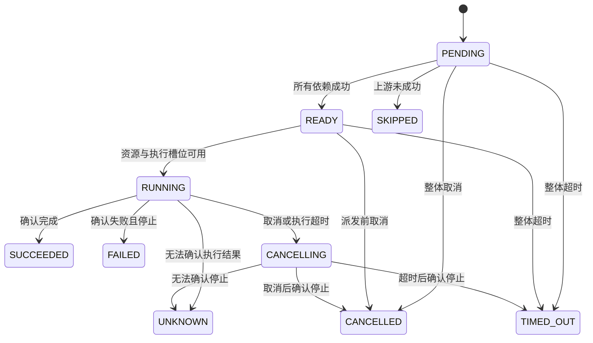
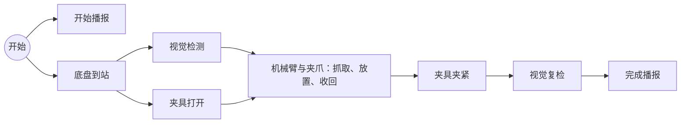

# Orchestrion 多设备任务调度与规划架构

状态：架构提案与可运行的第一阶段实现。新 API 位于 `orchestrion.workflow`，目前为实验接口；现有 `TaskPilot` 保持兼容。这里的 v3 指架构迭代，**并未发布 3.0 包版本**。

## 1. 核心决定

将 Orchestrion 从“主机械臂驱动外设”的工具，演进为**面向能力的工作流执行系统**。机械臂、夹具、语音、视觉和底盘都是能力提供者，没有哪个设备天然拥有整个调度器。

系统需要分别回答四个问题：

1. **要达到什么状态？** 任务规划器根据目标、环境和设备能力产生候选计划。
2. **哪些动作可以在什么时候执行？** 工作流引擎检查依赖，调度器处理资源、优先级和执行容量。
3. **这个动作如何在设备上完成？** 适配器负责协议、反馈、设备状态和停止确认。
4. **设备如何实时、安全地运动？** 运动控制器、底盘导航栈、PLC 和设备保护系统负责闭环控制与联锁。

不存在对所有设备和部署都“完全完美”的架构。这里选择可验证的约束、清楚的故障语义和渐进迁移：先建立可靠的单进程控制核心，再按真实需求增加持久化与分布式能力。

## 2. 总体结构



图中是目标架构，不表示每个框已经实现。当前完成了候选工作流、编译校验、内存运行时、资源调度、适配器契约和有限事件记录；后文列出剩余工作。

默认部署为一个设备域对应一个 `WorkflowEngine`。视觉推理和语音识别可以运行在独立进程或远程服务；引擎本身不必因此拆成微服务。机器人 SDK、ROS 2、HTTP、gRPC 是适配器的实现选择，不进入任务模型。

## 3. 概念与职责

| 概念 | 定义 | 示例 |
| --- | --- | --- |
| Mission / Goal | 希望达到的业务状态，可产生多版计划 | 把零件 A 安装到工位 B 并完成检测 |
| Planner | 从目标、世界快照和能力目录产生候选工作流 | 根据零件位置选择抓取、放置和检测顺序 |
| Workflow | 一次执行所使用的确定依赖图 | 到站 → 检测与开夹具 → 放置 → 夹紧 → 复检 |
| Node | 一次能力调用，含输入、依赖、资源附加要求、优先级、超时 | `inspect_42` 调用 `vision.detect` |
| Action / Capability | 有明确输入、输出、资源和完成语义的设备能力 | `arm.pick_place`、`base.navigate`、`speech.say` |
| Adapter | 能力的实现，确认操作最终结果并处理协议差异 | ROS 2 Action 客户端、SDK 封装 |
| Resource | 具有容量的执行约束；可以是设备，也可以是空间或计算配额 | 左臂、共享工作区、GPU 槽位、扬声器 |
| Operation | 一次实际调用的身份，目标设计中跨传输重试保持不变 | 当前 `run_id/node_id` |
| Artifact | 大数据的外部引用 | 图像 URI、点云摘要、轨迹文件 ID |
| World fact | 带观测时间和来源的事实 | 夹具已夹紧、机械臂已收回、目标位姿 |

现有 `GenericTask` 名称保留在兼容 API 中。新核心避免继续用一个 Task 同时表示设备对象、函数包装、任务节点和整段业务流程。

能力目录由设备集成层建立。规划器选择已注册能力，不能在计划中注入 Python 函数、任意导入路径或新的设备权限。

## 4. 五类设备如何接入

| 设备或服务 | 典型能力 | 资源与状态约束 | 真正的完成条件 |
| --- | --- | --- | --- |
| 机械臂 | 移动、执行轨迹、抓取放置、回安全位 | 机械臂、末端工具、工作区、底盘运动联锁 | 控制器确认动作结束；失败时确认已停止或进入未知状态 |
| 夹爪与夹具 | 开合、夹紧、松开、压力检查 | 夹爪/夹具执行通道、工作区；物体占有状态另行记录 | 到位/压力/夹持反馈满足要求 |
| 语音 | 播报、一次识别、意图解析 | 扬声器串行；麦克风会话、服务并发额度 | 播放结束或识别会话结束，而不是仅收到请求 |
| 视觉 | 采集、检测、姿态估计、复检 | 相机采集模式、GPU 容量；图像时效与坐标系 | 得到符合输出契约的结果及其观测元数据 |
| 底盘 | 导航、停靠、对接、停止 | 底盘、通道/区域；机械臂收回等联锁 | 导航端确认成功或停止，不能把目标受理当成到达 |

连续图像、点云、音频和遥测是**数据流**。一次检测、一次导航、一次播报是**动作**。数据流更新世界状态或生成有背压的事件，由任务管理层决定是否触发新动作；不要把无限数据流塞进一个永远不完成的 DAG 节点。

阻塞 SDK 使用 `BlockingAction` 或专用设备线程。纯 Python CPU 密集视觉计算使用独立进程或计算服务；普通线程池并不意味着获得 CPU 计算扩展。适配器初始化和连接生命周期由应用启动阶段管理，目前引擎不自动管理设备连接。

## 5. 规划与调度的边界

规划器的输出是提案，运行时负责验证和执行。规则、HTN、符号搜索、优化求解器或模型生成器可以实现相同的 `Planner` 协议：

```python
async def plan(goal, world, catalog) -> Workflow:
    ...

workflow = await planner.plan(goal, world_snapshot, engine.describe())
preview = engine.validate(workflow)  # 无设备 I/O
run = engine.submit(workflow)       # 重新校验并保存执行快照
```

当前示例中的 `CellPlanner` 是规则规划器；核心没有内置通用自动任务规划、碰撞规划或语言模型服务。

`validate()` 返回完整的节点参数、引用、依赖和资源预览。预览中的 `$output` 表示 `OutputRef`，目前只用于展示，没有提供把任意 JSON 自动反序列化为可执行计划的入口。

计划编译器负责结构合法性、静态绑定、资源可行性以及已知输入的检查。运行时在引用解析之后再次检查输入。输出依赖的字段类型、现场姿态和设备就绪状态只能在数据可用或实际执行前确定，静态编译不能证明物理可行性。

含有 `OutputRef` 的输入也逐字段检查已知部分，包括必填字段、未知字段、固定值的类型与范围、嵌套对象、数组长度及组合枚举中的固定成员。只有引用本身等待结果；例如姿态来自视觉输出时，超出范围的固定速度仍会在任何设备动作前拒绝。预览和提交共用此校验，拒绝的计划不会占用幂等键或运行配额。

能力可同时声明 `Action.input_schema` 和 `Action.output_schema`，两者均进入规划器目录。声明输出契约后，编译器提前拒绝该契约下不可能成立的引用，例如封闭对象中的未知字段、对字符串作数组访问、超过数组 `max_items` 上界的下标。可选字段、未声明子结构的对象/数组和允许额外字段的对象仍保留运行时检查；静态通过不保证实际数据包含该路径。

三种规划层次不应混用：

| 层次 | 决定什么 | 推荐边界 |
| --- | --- | --- |
| 任务规划 | 操作顺序、对象与能力选择、业务条件 | Orchestrion 的 `Planner` 与任务管理层 |
| 运动/导航规划 | 无碰撞轨迹、路径、抓取姿态、局部重规划 | MoveIt、Nav2 或自有领域规划器，由能力适配器调用 |
| 实时控制 | 插补、力控、伺服、制动、即时联锁 | 机器人控制器、实时组件、PLC |

MoveIt Task Constructor 将复杂操作分成交换规划状态的阶段，可作为机械臂领域规划器。Nav2 使用行为树组织导航行为与恢复，可作为底盘动作内部的反应式执行系统。这里据此采用“任务层组合能力，领域层负责领域规划”的边界。[MoveIt Task Constructor](https://moveit.picknik.ai/main/doc/concepts/moveit_task_constructor/moveit_task_constructor.html)、[Nav2 行为树](https://docs.nav2.org/behavior_trees/overview/detailed_behavior_tree_walkthrough)

固定 DAG 适合执行一个已确定的计划，行为树或任务状态机适合持续条件判断和恢复策略。目标架构允许上层状态机根据结果生成下一版 DAG；当前运行时不支持在运行中修改图。先停止受影响的操作并确认结果，再以新世界快照重规划，不直接改写已经派发的动作。

## 6. 资源模型：设备互斥只是第一步

当前实现采用整数容量和原子申请：一次动作要么获得全部声明资源，要么一个也不占用。能力上的资源声明是最低要求，节点可以增加资源或提高用量，不能降低最低要求。

```python
resources = [Resource("arm"), Resource("platform_motion"), Resource("gpu", 2)]
action = Action("arm.move", move_adapter, (
    ResourceClaim("arm"), ResourceClaim("platform_motion"),
))
```

底盘导航也声明 `platform_motion`，即可表达这个部署中“底盘和机械臂运动互斥”的约束。资源名字没有隐含层级：`robot` 与 `robot.arm` 不会自动冲突，部署配置必须明确声明共有资源。若设备确实支持协调运动，则由一个协调能力一次取得相关资源，交给协调控制器执行。

当前调度策略是非抢占优先级，相同优先级按进入 READY 的顺序执行。每个资源维护有序等待队列，多资源动作在所有相关队列中都排到前面才可执行。等待中的双资源动作不会长期被后来的单资源动作插队；不相关的设备仍可运行。容量资源可以同时服务多个动作。持续到达的高优先级工作仍可能让低优先级工作饥饿；优先级老化、租户配额和截止时间调度属于后续策略。

**资源释放与物理状态变化是两件事。** `fixture.clamp` 完成后可以释放夹具的命令通道，但夹紧事实持续存在。抓着物体的夹爪也不会因为一个节点结束就自动松开。目标架构需要对象占有关系、持久联锁和跨节点 reservation scope。

第一阶段用组合能力表达必须连续占有资源的临界区。示例 `arm.pick_place` 从接近、抓取、放置直到收回始终占有机械臂、夹爪、夹具、工作区和底盘运动联锁。不能把它拆成互不相连、每一步都释放工作区的普通节点，然后假设整段流程仍受保护。

组合适配器在已持有的资源范围内直接调用领域驱动。当前资源锁不可重入，同引擎的嵌套等待还可能耗尽执行槽位。运行时拒绝在动作内部等待本引擎尚未完成的运行，或等待本引擎关闭；检查也覆盖继承动作上下文的子协程。使用图依赖表达顺序，需要停止时可调用非阻塞的 `run.cancel()`。可嵌套的工作流和作用域资源继承需要在后续版本中显式设计。

设备还须在获得资源后检查实时前置条件。例如，视觉检测之后另一任务可能移动底盘，因此放置动作必须重新检查工位、坐标系和观测时效。单靠互斥锁不能替代这些检查。

当前资源所有权只在一个引擎进程内成立。两个引擎、两个进程或旧 `TaskPilot` 与新引擎同时直接控制同一设备，会绕过这种互斥；迁移时必须保持每个物理设备只有一个命令所有者。

## 7. 生命周期、取消、超时和未知结果



这是主要状态转换，依赖取消、主动返回 `ActionCancelled` 等还有相应终态。`UNKNOWN` 是记录上的终态，但不是设备已停止的证明；运行结果为 `NEEDS_ATTENTION`，已取得的资源保持隔离占用。

ROS 2 Action 本身也区分取消中的状态和已取消的终态。接到取消响应后仍需等待最终结果。因此 ROS 2 适配器不能把取消请求被接受映射为本系统的最终 `CANCELLED`。[ROS 2 Action 状态与取消协议](https://design.ros2.org/articles/actions.html)

当前适配器契约：

- 正常返回：操作已经结束，结果是最终结果。
- 普通异常：操作失败，并且适配器确认它不再执行。
- `ActionCancelled`：清理结束，操作已经停止。
- `ExecutionUncertain`：可能仍在执行，保留全部资源。
- 意外的 `asyncio.CancelledError`：也按未知处理，不能据此假定远端设备停止。

引擎只通过 `ActionContext` 发出合作式取消，不直接 `Task.cancel()` 正常运行中的适配器。阻塞 SDK 的线程不能被 Python 可靠地停止，`BlockingAction` 会等待函数真正结束；函数必须等待设备完成，不能只发送命令后立即返回。它使用共享内存的 `ThreadPoolExecutor` 或事件循环默认线程池；SDK 包装器出队时再次检查线程安全的取消信号，已知取消的调用不会再进入 SDK。进程池任务需要单独的进程协议，不通过此线程适配器提交。

动作可以从 SDK 回调线程调用 `context.report()`。反馈在提交时复制，交回所属事件循环后才追加事件；动作结束后的迟到反馈会丢弃。等待取消和 `context.sleep()` 仍必须在原事件循环中调用。已经完成的上下文不能重新等待或启动新的 `BlockingAction`，避免脱离资源所有权继续发出 SDK 命令。

SDK 线程反馈使用每动作独立的有界队列，`max_pending_feedback_per_action` 默认 128。队列满时丢弃最旧的待投递进度，保留较新的进度；投递 `feedback_overflow` 事件，并在最终 `NodeResult.feedback_dropped` 中保留丢弃总数，事件历史被淘汰后仍可查询。每动作至多排入一个消费通知，每次消费最多 32 条后让出事件循环；动作完成时先刷新尚未投递的有界队列，再记录终态。纯事件循环内的反馈直接投递，SDK 队列按需创建。

进度通道不提供无损消息传输。控制命令、关键结果、语音服务的最终识别文本等应由设备协议或最终输出承载。容量限制按条数计算，队列之外还可能有一批正在投递的反馈；单条图像/点云等大对象应改为 artifact 引用。

四种“超时”必须区分：

| 超时 | 当前行为 |
| --- | --- |
| `run.wait(timeout=...)` | 只限制调用方等待，不取消底层运行；取消等待协程也不取消工作流 |
| `Workflow(timeout=...)` | 从编译校验后的运行接收阶段开始，用同一预算覆盖依赖等待、资源排队和执行；到期停止所有未完成节点，运行中的设备仍需确认停止 |
| `Node(timeout=...)` | 从适配器执行开始计时，到期请求停止；资源等待时间不计入，清理完成前保持 CANCELLING |
| `engine.aclose(timeout=...)` | 关闭提交入口并请求停止，等待超时后抛出异常；活动资源继续保留，可再次等待关闭 |

预算使用事件循环的单调时钟。整体超时后，尚未启动的节点统一记录为 `TIMED_OUT`，正在执行的节点先进入 `CANCELLING`；清理结束后运行结果为 `FAILED`，存在未知操作则为 `NEEDS_ATTENTION`。已经完成的节点保持原结果，整体成功完成后到来的取消也不会重写成功。

调度协程被中止、异常退出或仍有活动运行时提前返回，会关闭提交入口，并在 `scheduler_snapshot()["scheduler_error"]` 保留错误。尚未进入适配器的节点记录失败并释放已取得的预约；已排队的执行协程在调用适配器之前再次检查调度故障。已运行的动作收到 `scheduler_failed` 停止原因，原有更早的取消/超时原因保持不变，资源继续等待停止确认。运行完成通知独立于调度协程，`run.wait()` 与 `aclose()` 仍可等待收尾；未知操作依然隔离，故障引擎不自动重启。初始调度任务创建失败仍按提交失败回滚，不留下已接受的执行或幂等键。

每次准备派发设备命令时重新检查整体预算，并在动作返回后复核已用时间，避免定时回调被延迟时误报成功。这只能约束软件结果与后续派发，无法强制停止占用事件循环或不合作的设备。独立排队期限、独立停止期限和 watchdog 尚未实现，不能把超时当成硬实时停止保证。

恢复未知操作时，通过设备查询或可靠的现场确认获得证据，再调用：

```python
engine.confirm_quiescent(operation_id, evidence="controller stopped, revision 42")
```

这个方法记录证据并释放资源，不自动重发命令、不把历史 UNKNOWN 改写成成功。证据的真实性由设备集成层负责；方法本身不会验证一个字符串是否代表真实的物理停止。

`FAIL_FAST` 会停止派发其他节点、请求停止运行中的同伴，并等待清理；节点执行超时时立即启动这一策略，不等待该节点清理完成后才停止同伴。`CONTINUE_INDEPENDENT` 允许不依赖失败节点的分支继续，但仍受整体工作流预算约束。取消或失败不会逆转已经发生的物理效果，结果中可能保留已经完成的操作输出。

## 8. 重试、补偿与进程恢复

同一引擎内已经支持显式提交去重：

```python
run = engine.submit(workflow, idempotency_key="assembly-cycle-42")
replay = engine.submit(workflow, idempotency_key="assembly-cycle-42")
assert replay is run
retained = engine.get_run_by_key("assembly-cycle-42")
```

幂等键在派发前登记。同键同执行快照返回原运行，不重置整体预算；成功、失败、取消、超时和未知结果都不会因此重新执行。同键不同快照直接报错。比较包含能力名称、输入及其 JSON 类型、输出引用、有效资源声明、依赖、FIFO 顺序、优先级、节点/整体预算及失败策略。对象字段顺序不影响比较，普通 JSON 中形似 `$output` 的字段不会被误认为输出引用。只保留快照摘要，完成后释放计划输入。

`max_idempotency_keys` 默认 1024，达到上限后拒绝新的带键提交，仍可查询或重复提交已有键。不会因为后台淘汰而悄悄允许旧命令重发。长期运行服务通过 `prune_idempotency_keys(keep_last=1000)` 显式清理：只清理已完成且不存在未核对未知操作的键，按提交顺序保留最新的指定数量；活动运行和未知操作不计入可清理数量。清理后该键可以再次执行，已有运行句柄仍有效。关闭引擎仍保留可查询结果，但禁止新提交。

保留上限按键数量计算，不限制单个结果的字节数；图像、点云等大对象仍应走 artifact 存储。没有键的正常运行完成后由调用方句柄保留；未知操作由引擎继续保留。当前去重只覆盖同一个内存引擎，不能替代设备端幂等、持久化意图记录和崩溃恢复。

新工作流核心目前不自动重试动作。读取服务通常可以重试，夹爪开合、机械臂移动、付款式外部操作等有副作用的命令则必须依据具体契约决定。网络超时后直接再次发送“执行一次”可能产生重复动作。

目标设计为每个逻辑操作分配稳定 `operation_id`，每次传输或重试另有 `attempt_id`。设备端或代理端保存幂等去重记录和可查询结果。恢复流程为：

1. 在持久存储中写入运行版本、操作意图、资源拥有者及派发记录。
2. 发送带稳定操作 ID 的命令，持续记录受理、反馈、最终结果。
3. 崩溃恢复后先查询未决操作；确认完成则导入结果，确认未开始且允许重试才重新发送。
4. 无法查询或无法确认时进入未知状态，禁止自动重放有副作用的命令。

本地数据库事务不能与远端电机动作组成一个原子事务；架构不承诺跨设备的 exactly-once。分布式演进需要单一资源所有者、持久租约和设备端 fencing token，避免旧调度器复活后继续发命令。**租约过期不代表机器人已经停止**，不能直接把过期的物理资源重新分配。

补偿应是明确的业务恢复流程，并按正常资源规则调度。例如，“停止移动并保持抓持”可能比“立刻松开夹爪”更合适。依赖关系不构成通用逆操作，多个并行分支也不存在唯一的反向回滚顺序。当前只实现取消与失败传播，没有自动补偿执行器。

持久化首选先满足单进程恢复：在引擎边界增加可替换 RunStore/EventJournal，落盘状态转换、运行版本和未决操作；满足一致性测试后再考虑多个调度进程。当前有限事件历史只服务诊断，不是恢复日志，也不能用于断电恢复。

## 9. 世界状态、结果与大数据

目标 `WorldSnapshot` 至少包含版本、来源、观测时间、有效期以及坐标系/标定版本。位姿、检测置信度、夹具反馈和设备健康不能混成一个没有版本的共享字典。计划记录使用的快照版本，动作在执行前重新确认必要前置条件。

视觉输出建议采用以下形式，轨迹和音频遵循相同原则：

```json
{
  "artifact": {"uri": "artifact://capture/42", "media_type": "image/png"},
  "frame_id": "workcell",
  "observed_at": 1788590000.0,
  "calibration_version": "calib-7",
  "world_revision": 42,
  "objects": [{"id": "part-A", "pose": [0.4, 0.1, 0.2], "confidence": 0.98}]
}
```

目前节点输入、输出、反馈使用有限 JSON 值，`OutputRef` 可引用上游结果中的字段或列表元素，自动形成依赖。每次提交、传参和查询都隔离可变数据，避免调用者修改运行中的计划或下游修改上游结果。输入和可选输出契约复用现有 `RequestSchema`，支持嵌套对象、数组元素类型、数组长度、必填字段、数值范围及枚举。

```python
detection = RequestSchema({
    "pose": FieldSpec("array", required=True, items=FieldSpec("number"),
                      min_items=3, max_items=3),
    "frame_id": FieldSpec("string", required=True, choices=["workcell"]),
})
vision = Action("vision.detect", detect, output_schema=detection)
arm_input = RequestSchema({
    "detection": FieldSpec("object", required=True, object_schema=detection),
})
```

输出校验发生在适配器返回之后、记录成功与派发后继之前。输出契约要求实际 JSON 对象，不把 `None` 当成空结果。违反契约时，产生结果的节点记录 `FAILED` 和 `ActionOutputError`，依赖节点跳过；可用的原始 JSON 结果仍保留用于诊断。已发生的动作不会撤销或自动重发，普通返回仍必须表示设备已经结束；满足数据结构契约不能证明物理停止。`ExecutionUncertain` 不进入输出校验，继续保留未知资源。

嵌套错误包含完整字段路径，如 `objects[0].pose[1]`。字段约束在组装父 schema 和注册引擎时复制，后续修改调用方对象不会改变运行契约。示例对视觉姿态长度、坐标系、时间字段以及夹具、机械臂、语音最终结果均声明契约，并在执行前拒绝过期或来自未来的视觉时间。示例使用同进程时钟；远端设备接入需要时钟对齐或本地接收时间策略。单位系统、坐标变换校验、时钟同步和通用世界状态服务仍未实现。

共享 schema 提供 `validate_template(content, is_deferred=...)`，通过谓词识别待绑定值，不依赖工作流的具体引用类型；完整 `validate()` 仍用于实际派发。组合枚举逐成员比较 JSON 数据，区分嵌套布尔值与数值，避免把 `{"stopped": 1}` 当作 `{"stopped": true}` 的枚举确认。

当前限制的是节点数、活动运行数、并发动作数和事件条数，并没有严格的 payload 字节额度。大量图片不应进入这些字典；需要在接入真实视觉服务时增加 artifact 存储与输入大小限制。保留 `WorkflowRun` 句柄会保留最终结果；引擎会释放普通已完成运行，未知操作的记录保留到完成核对。

## 10. 实时控制、空间安全与部署约束

Python 工作流引擎负责业务级调度，不承担伺服周期或紧急停止。涉及机械臂与底盘精确时间同步、双臂接触、力控装配的动作应交给一个协调控制能力执行，工作流只管理其边界和资源。

资源锁只能表达已声明的冲突，不能检测模型外的碰撞。碰撞检查、速度限制、可达性、夹具联锁、硬件急停仍由对应领域规划器和控制系统落实。任务规划器不能覆盖设备联锁；模型生成的候选流程也必须经过同一套能力白名单和运行时校验。

先保持一个设备域一个权威命令入口。若以后需要多机任务分配，把“分配到哪台机器人”放在上层车队/任务分配层，把具体设备动作留在本地所有者。跨机器人共享区域再引入独立协调协议，而不是让每个本地引擎各自维护一份看似相同的锁。

## 11. 模块与迁移路线

现阶段代码组织：

```text
orchestrion/
  task_pilot.py                 # 兼容的主机械臂与外设 API
  tasks/                       # 现有设备抽象与适配器
  workflow/
    model.py                   # 工作流、资源、引用、结果、状态
    actions.py                 # ActionContext、Action、BlockingAction、Planner
    compiler.py                # 全图校验、依赖提取、输入绑定
    engine.py                  # 执行、全局资源所有权、取消、事件
    diagnostics.py             # 按需等待原因、资源占用者与运行统计
    feedback.py                # SDK 反馈容量、批量通知、溢出统计
examples/
  heterogeneous_workflow.py    # 五类设备与规则规划器示例
tests/
  test_workflow.py
  test_heterogeneous_workflow.py
```

后续按实现需要增加 `planning/`、`world/`、`persistence/`、`adapters/ros2/` 等边界；当前不先创建没有实现的空框架。资源仲裁在单事件循环内与状态转换原子协作，等需要替换调度策略时再抽出独立策略接口。

| 阶段 | 工作 | 完成标准 |
| --- | --- | --- |
| 第一阶段：当前 | 无主设备 DAG、能力契约、原子资源、数据依赖、合作取消、整体预算、幂等提交、等待诊断、未知隔离、模拟场景 | 单元测试与五类设备流程通过，旧 API 回归通过 |
| 第二阶段：设备接入 | 选择实际机械臂/夹具/底盘 SDK 或 ROS 2，落实操作查询和停止确认，加入设备就绪与世界状态校验 | 每个适配器通过断连、拒绝、重复命令、延迟停止、控制器重启测试 |
| 第三阶段：运行可靠性 | 持久运行记录、恢复核对、显式补偿、跨节点资源范围、artifact 存储、独立停止期限 | 强制杀进程和网络故障后，不重复执行、不把未知资源重新派发 |
| 第四阶段：规划与多机 | 带条件的任务管理、重规划、资源绑定优化、公平性策略、多设备域协调 | 用实际任务集比较成功率、等待时间、恢复时间和资源利用率 |

迁移以一个完整设备域为单位。旧 `TaskPilot` 可以继续运行现有例子；新流程先在仿真域使用 `WorkflowEngine`。需要复用旧设备时，适配器可以调用其接口，但必须补齐最终完成和停止确认语义，并停止旧调度器对该设备的直接提交。当前没有声称通用的 `TaskPilot` 自动桥接器已经完成。

不能仅因旧接口返回 `CANCELLED` 就判定真实设备已停止，也不能把旧 `move_id` 当成新工作流的全局身份。保持旧接口兼容，比立即改写全部旧类更便于定位回归；未来可在设备适配完成后逐步把旧外观转发到新内核。

## 12. 运行与验证

本次测试、隔离安装与性能数据见 [验证记录](workflow-validation-2026-09-05.md)。

```bash
python -m examples.heterogeneous_workflow --preview
python -m examples.heterogeneous_workflow
python -m pytest -q tests/test_workflow*.py tests/test_heterogeneous_workflow.py
python -m pytest -q
ruff check orchestrion integrations tests examples
python -m examples.benchmark_workflow --counts 1000 5000 --repeats 3
```

示例流程：



验证重点包括：跨工作流资源互斥与容量、相同资源的 FIFO 与优先级、原子多资源申请、取消期间资源保持、未知结果隔离、等待超时不改变执行、失败分支传播、静态图拒绝、动态数据校验、输入/输出快照、有限事件历史和关闭超时。

排查停滞时，在引擎所属事件循环调用 `run.explain(node_id)`：返回该节点的当前状态与依赖、全局并发、资源容量、资源队首、停止确认或未知隔离原因。容量阻塞包含资源占用者的 `operation_id`；即使资源还有空位，也会显示因多资源队首公平性而等待的前序操作。未知操作经核对后历史状态仍为 `UNKNOWN`，阻塞项则消失。

`engine.scheduler_snapshot()` 汇总活动运行中的节点状态、运行中动作数、资源占用者、队列长度/队首、幂等键容量和可清理数量，以及调度故障。节点解释另包含反馈积压和丢弃计数。完成运行的未知资源在独立占用信息中继续可见。这些接口按需扫描内存、不调用设备、不调整调度队列；不是订阅遥测，也不是硬件健康确认。

性能上，依赖完成只遍历受影响的后继边；资源等待使用每资源优先队列，只唤醒相关队首，避免每个动作完成都扫描整张 DAG 或同一设备的整个积压队列。取消时集中清理失效队列项，防止被长期占用的资源保留已取消运行。这里的优化针对调度开销，不代表真实机械臂、网络或视觉服务的吞吐量。
